# Mahjong Companion

#### Created by Nick Pranske

My wife has gotten really into Mahjong lately. It's a game that we get to play together and introduce to friends who have never played it! It's really quite fun - the only problem is that **she usually beats me!** Well, that ends today. I built this app as a table-side companion to help me strategize and win against her.

This project is also one of my first experiences in heavily relying on AI to do most of the programming. There were defintely ups and downs of this.

##### The Pros:
1. Development was rapid and code is insanely organized (more on that in the cons)
2. Organization of this repository was very easy
3. Ability to iterate and improve was made much easier

##### The Cons:
1. My understanding of the project got out of hand as development quickly grew. This caused me to have to *read* code more than *write* it.
2. Ultra-optimization of the code makes it harder for me to read.


I built this both as a way to one-up my wife and as a portfolio project to showcase certain skills: **LLM agent orchestration**, **AI observability** and **cloud infrastructure**. This page walks through each of them. I had Claude organize this page to help the reader understand the architecture. This took a lot of iterations and input on my end, and I'm quite pleased with the accuracy of the result.

<table>
  <tr>
    <td valign="top" width="33%">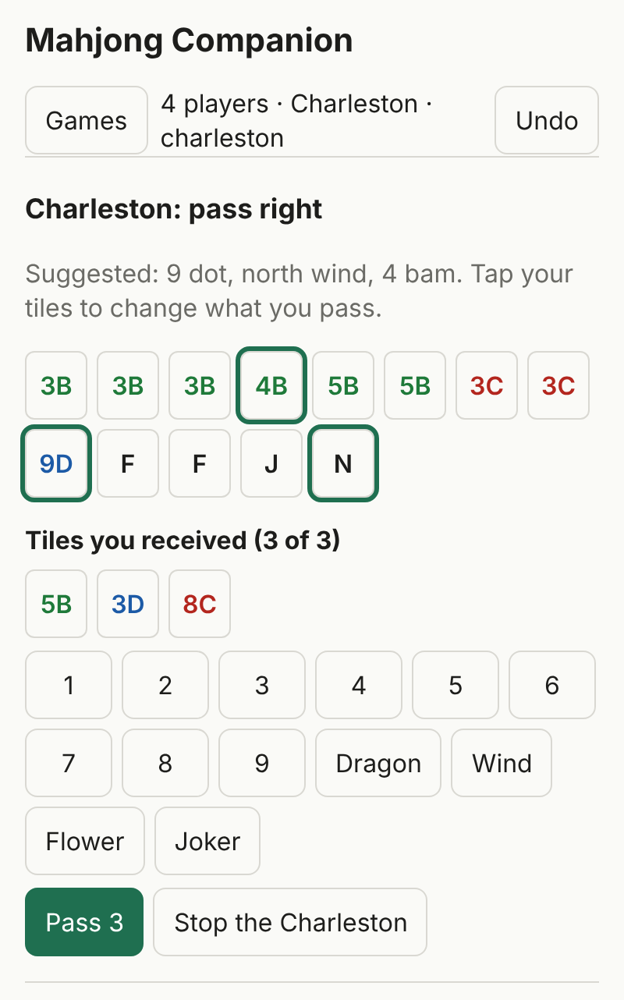</td>
    <td valign="top" width="33%">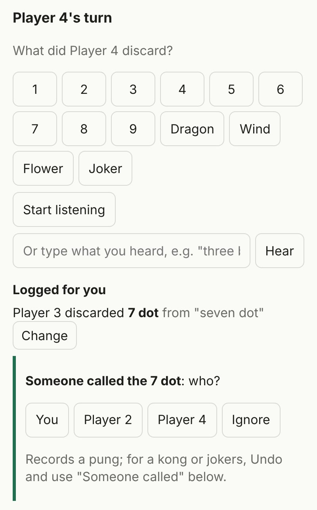</td>
    <td valign="top" width="33%">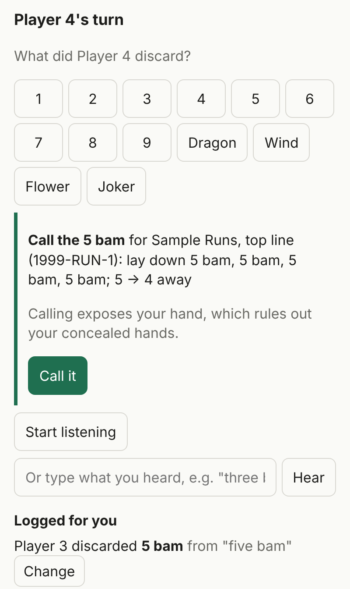</td>
  </tr>
  <tr>
    <td valign="top"><em>Charleston: the tiles worth passing are already selected.</em></td>
    <td valign="top"><em>Listening: "seven dot" was logged for me. Then someone said "call", so it asks who.</em></td>
    <td valign="top"><em>A discard I can use: what to call and what it gets me.</em></td>
  </tr>
</table>

<sub>Every screenshot on this page is the real app, run locally on a made-up sample card (hence "Sample Runs" and the year 1999). The actual card is copyrighted and never leaves private storage.</sub>

## Contents

1. [The game, and the problem](#the-game-and-the-problem)
2. [The one rule: the engine counts, the AI judges](#the-one-rule-the-engine-counts-the-ai-judges)
3. [Part 1: LLM orchestration](#part-1-llm-orchestration)
4. [Part 2: AI observability](#part-2-ai-observability)
5. [Part 3: Cloud infrastructure](#part-3-cloud-infrastructure)
6. [What is in this folder](#what-is-in-this-folder)
7. [What is not here, and why](#what-is-not-here-and-why)
8. [Design decisions](#design-decisions)
9. [Where it stands](#where-it-stands)

---

## The game, and the problem

American Mahjong is played with 152 tiles and a printed card of legal hands that changes every year. You win by building one of the hands on the card, 14 tiles exactly. The 2024 card has 55 hands, and because many of them allow "any suit" or "any three consecutive numbers", they expand to 1,683 distinct 14-tile targets.

So in the middle of a game there is a lot to hold in your head: which of those targets my tiles are close to, which tiles I still need have already been discarded, and what the other players seem to be collecting. The Companion keeps track of all of it on my phone.

## The one rule: the engine counts, the AI judges

Language models are unreliable at counting tiles. They are good at reading photos, making sense of messy speech and weighing soft signals. The whole design follows from that:

- A **rules engine** in plain Python, with no AI and no network calls, does everything that can be counted: every hand on the card, tiles still needed, live tiles left, dead hands, joker swaps, the best Charleston pass, whose turn it is.
- Each **AI part** sits at the edge. It either turns raw input (a photo, a sentence) into an event for the engine, or it chooses among options the engine has already scored.

Two things fall out of this. Every AI part can be measured against ground truth, because the engine or the player always knows the right answer. And the app still works with taps alone if every model is switched off.

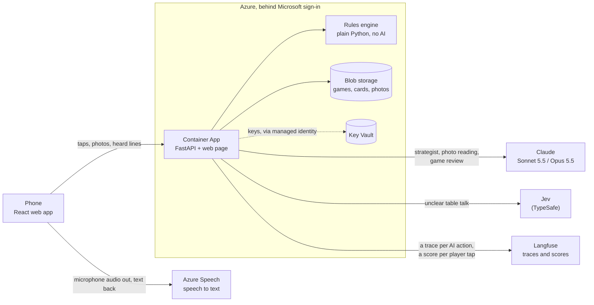

| Job | Done by |
| --- | --- |
| Every 14-tile target behind each card line, and validating a card file | Engine |
| Tiles still needed, live tiles, dead hands, joker swaps, ranking the hands | Engine |
| Which three tiles to pass in the Charleston, and the best discard | Engine |
| Whether to call a discard, and what each opponent is probably building | Engine |
| Game state: turns, calls, exposures, undo (a list of events, replayed) | Engine |
| **Which of the top hands to go for, and why** | Claude agent, choosing only among the engine's top 5 |
| **Reading tiles from a photo** | Claude vision, limited by schema to the 36 tile names |
| **Drafting a new year's card from a photo** | Claude, checked by the engine's validator in a loop |
| **Turning table talk into events** | Grammar parser first, a small typed model (Jev) for unclear lines |
| Replaying a finished game: what the engine would have done at each of my moves, and how each strategist pick fared | Engine |
| **Coaching me on that game, and grading the strategist with hindsight** | Claude, told only what the engine's replay found |

---

## Part 1: LLM orchestration

There are five AI jobs, and each one has a different shape. I picked the smallest pattern that does the job, and the cheapest model that does it well.

| Job | Pattern | Model | Kept honest by |
| --- | --- | --- | --- |
| [Strategist](#the-strategist-an-agent-that-can-only-pick-from-the-engines-list) | Agent loop with tools | Claude Sonnet 5.5, low effort | Must answer through a tool, naming one of the engine's top 5 hands |
| [Photo reading](#reading-a-rack-photo-structured-output-not-free-text) | One call, structured output | Claude Sonnet 5.5 vision, low effort | A JSON schema that only allows the 36 real tile names |
| [Card drafting](#drafting-the-yearly-card-generate-validate-repair) | Generate, validate, repair | Claude Opus 5.5, high effort | The engine's validator, up to 4 rounds, then my review |
| [Table talk](#table-talk-rules-first-a-small-model-for-the-leftovers) | Cascade: rules, then a small model | Grammar parser, then Jev | Typed answers with probabilities, a measured cut-off, and my confirm tap |
| [Score My Game](#score-my-game-claude-reviews-the-finished-game) | Engine replay, then one call with structured output | Claude Opus 5.5, medium effort | Sees only the engine's facts; any move or ask it cites must exist (Part 2) |

### The strategist: an agent that can only pick from the engine's list

When I tap **Ask the strategist**, the engine ranks every hand on the card and hands Claude the top five, with tiles needed, live "outs" and joker swaps already counted. Claude's job is the judgment the engine can't make: are two opponents throwing away the suit I need, is a concealed hand worth giving up the right to call, is 17 outs better than 13 at the same distance.

<p align="center">
  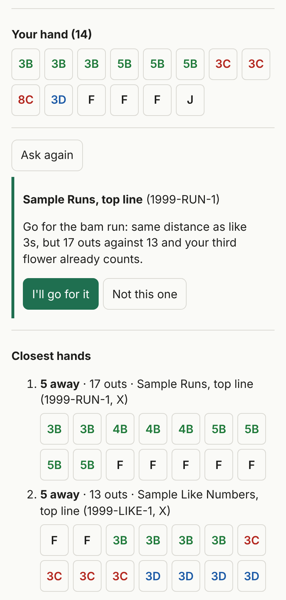<br/>
  <em>The pick sits between my hand and the engine's ranking. The two buttons under it become a score in Langfuse.</em>
</p>

<sub>This showcase was captured without any API key, so here the model call is replaced by the test suite's scripted stand-in (<code>FakeClaude</code>) and the wording of the reason is a placeholder. Everything else on screen is live output from the engine.</sub>

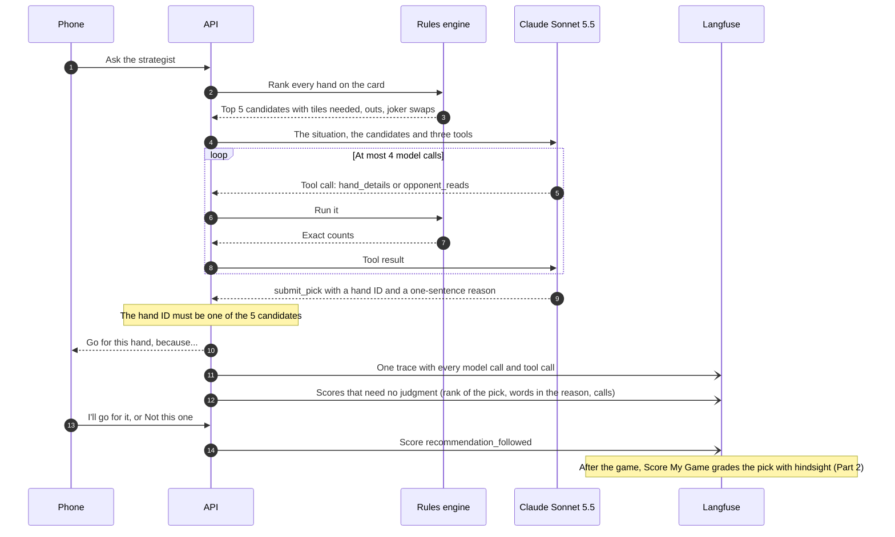

What makes it an orchestration problem rather than a prompt:

- **Three tools, all strict.** `hand_details` (the closest ways to finish one candidate), `opponent_reads` (each opponent's discards, exposures and the engine's guess at their hand), and `submit_pick` (the only way to answer).
- **It cannot invent a hand.** A `submit_pick` whose hand ID is not one of the five candidates is returned to the model as a tool error listing the valid IDs, and it tries again.
- **A text answer is nudged, not accepted.** If the model replies in prose, the loop answers "Call submit_pick with your choice."
- **A hard stop.** After 4 model calls with no pick, the request fails cleanly and the trace is marked as an error.
- **Refusals are handled twice.** Server-side fallback is on, so a declined request is retried on Anthropic's recommended fallback model, and a refusal that still comes back is an error rather than an empty answer.
- **Cheap on purpose.** Low effort, prompt caching, and it only runs when I tap the button: about a cent per ask, $0.08 to $0.17 over a game.

The loop itself is short. Abridged from [`LLM_Orchestration/strategist.py`](LLM_Orchestration/strategist.py):

```python
for round_number in range(1, MAX_CALLS + 1):  # 4
    tally.llm_calls += 1
    response = _call_claude(client, langfuse, messages, round_number)
    if response.stop_reason == "refusal":
        tally.outcome = "refused"
        raise StrategistError("The model declined to answer")
    messages.append({"role": "assistant", "content": response.content})
    results = []
    for block in response.content:
        if block.type != "tool_use":
            continue
        if block.name == "submit_pick":
            if block.input.get("hand_id") in by_id:
                tally.outcome = "picked"
                return pick  # only an engine candidate gets out
            tally.rejected_picks += 1  # an invented hand: counted, then sent back as an error
        else:
            tally.tool_calls += 1
        output = _run_tool(langfuse, block, card, state, by_id, reads)
        results.append({"type": "tool_result", "tool_use_id": block.id, "content": json.dumps(output)})
    if not results:
        # Answered in text instead of calling the tool: ask once more.
        tally.nudges += 1
        results = [{"type": "text", "text": "Call submit_pick with your choice."}]
    messages.append({"role": "user", "content": results})
```

The `tally` is not just bookkeeping: when the ask ends, it becomes scores on the trace (how many calls, how many invented hands, how it ended), which is where [Part 2](#part-2-ai-observability) picks up.

Each of those rules has a test that runs with a scripted model, so the suite needs no key and costs nothing: [`LLM_Orchestration/test_strategist.py`](LLM_Orchestration/test_strategist.py).

### Reading a rack photo: structured output, not free text

At the start of a game I photograph my rack instead of tapping in 13 tiles. The phone shrinks the photo to 1568 px, and Claude answers in a fixed JSON shape:

```python
"tile": {"type": "string", "enum": TILE_NAMES},   # the engine's 36 tile names and nothing else
"uncertain": {"type": "boolean"},                 # "I could be wrong about this one"
```

Because the names come from the engine, the reading drops straight into the tile picker. Tiles flagged `uncertain` are highlighted for me to check, and every tile I change is counted.

<p align="center">
  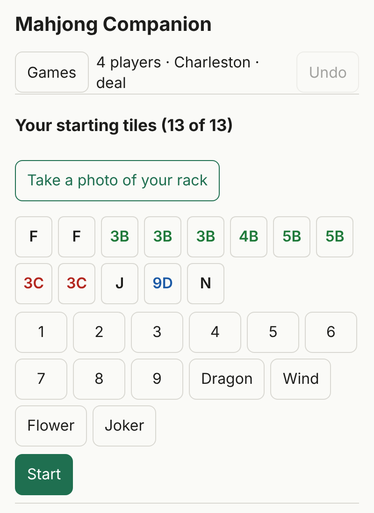<br/>
  <em>Photo or taps: both end in the same list of tiles, which I confirm before the game starts.</em>
</p>

The prompt was tuned by measuring, not guessing. A generic description of a Mahjong set read 40 of 43 single-tile photos correctly. Looking at the three misses showed why: my set marks the green dragon with an "F", its 8 bam looks like a W over an M, and one flower is drawn as bamboo. Describing the set I actually own raised it to 42 of 43. The prompt and schema are in [`LLM_Orchestration/vision.py`](LLM_Orchestration/vision.py).

### Drafting the yearly card: generate, validate, repair

A new card comes out every year, and typing its 50-odd hands into a file is slow and easy to get wrong. So I photograph the card, and Claude Opus 5.5 transcribes it into the engine's card format. This is the one job where accuracy matters far more than speed or cost (it runs once a year), so it gets the most capable model at high effort.

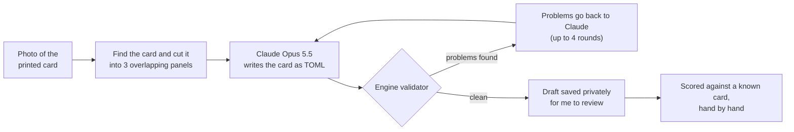

The model never grades its own work. The engine parses each draft and checks every hand: is it valid TOML, does every variant come to 14 tiles, are there enough of each tile in the set (or jokers allowed to cover the gap). What it finds goes back word for word. For example, this is what the validator says when one tile is missing from a hand on the made-up sample card:

```
1999-RUN-3: 13 tiles instead of 14 in 2x flower 1x 2 bam 1x 4 bam 1x 6 bam 1x 8 bam ...
```

Accuracy is scored **by meaning, not spelling**: a drafted hand counts as right only if it expands to exactly the same set of 14-tile targets, with the same value and concealed flag, as the same hand in a card file I already trust. On the 2024 card the draft got 54 of 55 hands right in a single round. A card costs roughly $0.25 to $1 to draft. Code: [`LLM_Orchestration/card_draft.py`](LLM_Orchestration/card_draft.py). The made-up card it uses as its format example: [`LLM_Orchestration/sample_card.toml`](LLM_Orchestration/sample_card.toml).

### Table talk: rules first, a small model for the leftovers

Players announce what they discard: "three bam", "soap", "north". The phone streams microphone audio to Azure Speech and gets text back, one line at a time. Most lines don't need a model at all.

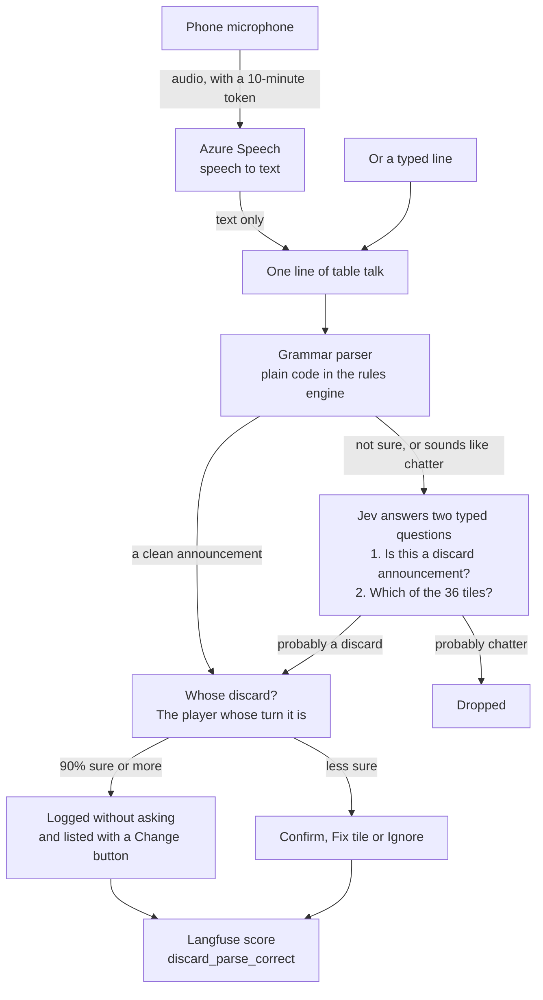

- **The parser handles the clean announcements.** It knows speech-to-text slips ("for dot" is 4 dot, "free crack" is 3 crak), reads a line sentence by sentence, splits two players' back-to-back announcements, and understands "three bam, no, four bam".
- **Jev only sees what the parser can't place.** [Jev](https://docs.typesafe.ai) (TypeSafe) answers typed questions with probabilities and writes no text. It gets two: a yes/no "is this a player naming the tile they are discarding now?", and a choice over the 36 tiles. A line costs about $0.00005. The model version is pinned, because the cut-off below was measured against it.
- **The cut-off was measured.** The vendor suggests 0.7 for a yes/no answer. On the 12 lines I calibrated with, announcements scored 0.93, 0.75, 0.75, 0.60, 0.48 and 0.17, and chatter scored 0.37 and below. At 0.7 half the announcements would be lost. At 0.4 it keeps 5 of 6 and drops all the chatter, and a stray proposal costs me one tap.
- **Who discarded comes from turn order, not voice.** Telling four voices apart in a noisy room is unreliable, so the app doesn't try. A discard belongs to whoever's turn it is, and a call moves the turn to the caller.
- **If Jev is down, the parser's reading stands**, so a line with a tile in it is still shown for me to confirm.

<p align="center">
  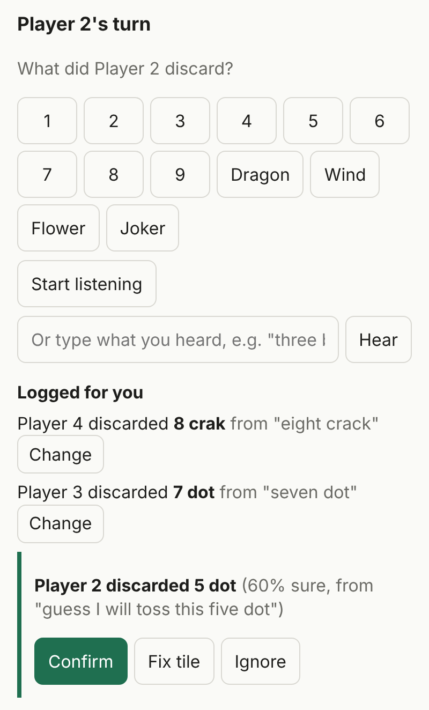<br/>
  <em>"Eight crack" and "seven dot" were logged on their own. "Guess I will toss this five dot" is only 60% sure, so it asks.</em>
</p>

Code: [`LLM_Orchestration/listen.py`](LLM_Orchestration/listen.py) and [`LLM_Orchestration/jev.py`](LLM_Orchestration/jev.py).

### What the engine adds around the AI

Not everything smart on the screen is a model. Calling advice and opponent reads are plain engine logic: an exposure is hard evidence about an opponent's hand, their discards are soft evidence, and with fewer than four discards the app says "too early to tell" instead of guessing. The strategist gets these reads through its `opponent_reads` tool.

<p align="center">
  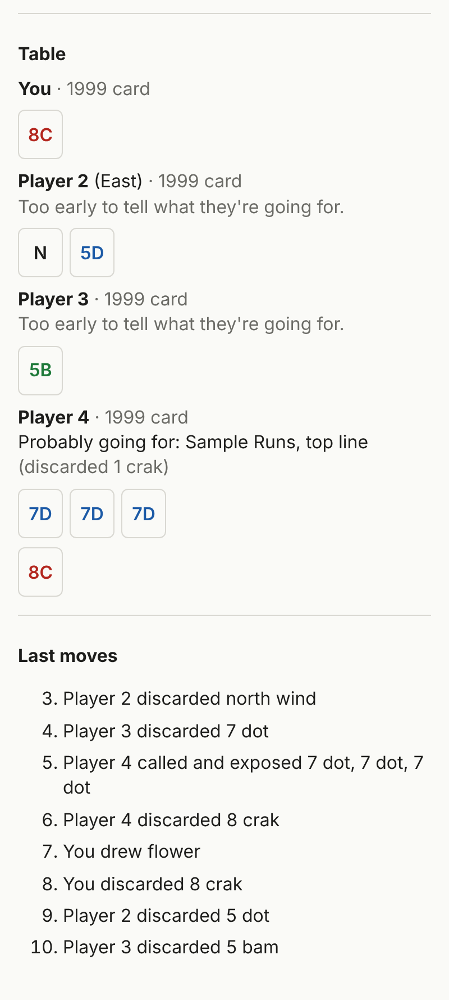<br/>
  <em>The table: who discarded what, what they exposed, and what that suggests.</em>
</p>

---

## Part 2: AI observability

Everything the AI does is recorded in [Langfuse](https://langfuse.com). The first version of this gave every feature a quality number from real play rather than a feeling. The second version, described here, is built to answer a harder question: **is the AI still as good, and as cheap, as it was last month?** A model behind a fixed name can change, prompts get edited, and the games themselves vary, so quality and token use can move without anyone deciding they should.

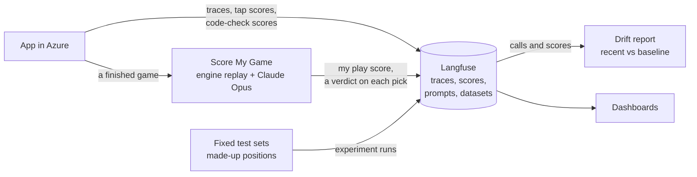

| Question | Answered by |
| --- | --- |
| What happened in this game, step by step? | [One trace per AI action](#one-trace-per-ai-action-one-session-per-game) and [the play-by-play](#the-game-as-a-play-by-play) |
| Was each answer any good? | [Three kinds of score](#three-kinds-of-score), one of them from [the game review](#score-my-game-claude-reviews-the-finished-game) |
| Can I trust the review? | [Keeping the reviewer honest](#keeping-the-reviewer-honest) |
| Has anything changed over time? | [Drift](#drift-has-anything-changed) |
| Where do I look? | [Dashboards](#dashboards-and-a-langfuse-project-kept-in-code) |

### One trace per AI action, one session per game

Each action is a trace, and all traces of one game share a session (the game's ID), so a game opens as a single timeline. This is what each trace looks like:

```
strategist                agent        in: the situation and the engine's 5 candidates   out: hand ID, reason, engine rank
├─ claude                 generation   claude-sonnet-5-5, effort low, tokens in/out/cached, why it stopped
├─ opponent_reads         tool
├─ claude                 generation
├─ hand_details           tool         in: {"hand_id": "1999-RUN-1"}
└─ claude                 generation   answers with submit_pick

heard                     chain        in: the line and whose turn    out: the proposed event, and what decided it
├─ parse-line             span         the grammar parser's reading and confidence
└─ jev                    generation   only when the parser is unsure: jev-1.13.0, tokens, cost, kept or dropped

read-hand                 generation   claude-sonnet-5-5 vision; the photo itself is never logged

draft-card                agent        session: the card's year       out: rounds used, hands found
├─ claude                 generation   claude-opus-5-5, effort high, time to first token
├─ validate               tool         out: hands parsed and the list of problems
├─ claude                 generation
└─ validate               tool         out: no problems

review-game               evaluator    in: moves, strategist picks    out: the review
├─ hindsight              span         the engine's replay: passes, discards, call chances, picks
└─ review                 generation   claude-opus-5-5, effort medium, a fixed JSON shape
```

Every trace also carries the same six labels. They are set in one place, [`AI_Observability/observability.py`](AI_Observability/observability.py), so no feature can forget one:

| Label | Values | Why it matters |
| --- | --- | --- |
| Environment | `production`, `development`, `eval`, `selftest` | Real games never mix with test runs |
| Release | The git commit of the deployed image | A change can be tied to a deploy |
| Session | The game's ID | One game is one timeline |
| Tag | `strategist`, `vision`, `table-talk`, `card-draft`, `play-by-play`, `review` | Cost and quality per feature |
| Prompt version | A fingerprint of the prompt text, linked to the prompt registered in Langfuse | A change can be tied to a prompt edit |
| Player | A hash of the signed-in account | Per-player numbers, without the account ID leaving the app |

A few choices worth pointing out:

- **Token usage includes cache reads and writes**, so the saving from prompt caching shows up in cost, not just in theory.
- **The model that actually answered is recorded.** Server-side fallback is on, so a refused request can be answered by another model. That generation is flagged and priced as the model that did the work.
- **Jev has no Langfuse integration, so I traced it by hand.** Each call is recorded as a generation with the pinned model, its token usage and a cost computed from the published price, so it sits next to the Claude calls in the same cost view.
- **Photos never go to Langfuse.** The trace records the prompt and the image size. The photo is kept in private storage with my corrected tiles, as training data for a future tile detector.
- **Errors are first-class.** A refused photo, an unreadable answer, a Jev outage or a strategist run that hits its call limit marks the trace as an error, with the reason. An answer that comes back unusable still records the tokens it cost.

### Three kinds of score

The app never asks me to rate anything. Scores come from three places, and each answers a different question:

| Kind | Examples | Answers |
| --- | --- | --- |
| My taps | `recommendation_followed`, `tile_fixes`, `discard_parse_correct`, `heard_outcome` | Was it useful to me? |
| Checks in code | `pick_engine_rank`, `reason_within_limit`, `strategist_rejected_picks`, `discards_auto_logged` | Did it do what it was told? |
| The game review | `strategist_hindsight`, `review_play_score` | Did the pick hold up, and how well did I play? |

**My taps.** The buttons I would press anyway are the feedback:

| Score | Created when I... | Value | Answers the question |
| --- | --- | --- | --- |
| `recommendation_followed` | tap "I'll go for it" or "Not this one" | 1 or 0 | Do I actually trust the strategist's picks? |
| `tile_cv_correct`, `tile_fixes` | confirm my tiles after a photo | share of tiles it read right, and how many I changed | How many fixes does a photo need? |
| `discard_parse_correct`, `heard_outcome` | confirm, fix or ignore a heard line (or leave an auto-logged one alone) | 1 or 0, and which of the four I did | How often is a discard logged with no correction? |
| `card_draft_accuracy` | run the card drafter against a known card | share of hands right | Can I trust a draft of next year's card? |
| `review_helpful` | tap "Useful" or "Not useful" under a game review | 1 or 0 | Is the reviewer worth what it costs? |

One detail I like: a discard that was logged automatically is scored 1 straight away, but its score has a fixed ID. If I later press **Change** on it, the same score is overwritten with 0. So "auto-logged and never corrected" and "auto-logged, then fixed" are told apart without any extra bookkeeping. Every score now works this way: one of each kind per trace, and scoring again overwrites.

**Checks in code.** Some things can simply be counted, so they are, the moment an answer comes back:

| Score | What it counts | Why I want it |
| --- | --- | --- |
| `pick_engine_rank` | Where the picked hand stood in the engine's closest-first list | Is the strategist adding judgment, or echoing the engine's top hand? |
| `reason_within_limit`, `reason_words` | Whether the one sentence kept to the 25 words the prompt asks for | Is it following its instructions? |
| `strategist_outcome` | How the ask ended: picked, refused, no pick, error | How often does it fail, and how? |
| `strategist_rejected_picks` | Times it named a hand outside the candidates before settling | Is the guard against invented hands doing any work? |
| `tiles_uncertain` | Tiles a photo reading flagged for me to check | Is it unsure about the tiles I end up fixing? |
| `game_won`, `discards_auto_logged`, `game_fixed_moves` | Whole-game numbers, scored on the session | How much of a game logs itself? |
| `review_dropped_refs` | Points in a game review that cited a move or a strategist ask that doesn't exist | Is the reviewer making things up? |

Every score is declared once, with its type and meaning, and nothing can be written under a name that isn't on the list. From [`AI_Observability/observability.py`](AI_Observability/observability.py):

```python
ScoreDef(
    "pick_engine_rank",
    "NUMERIC",
    "code",
    "Where the picked hand stood in the engine's closest-first list (1 = the closest).",
    min_value=1,
    max_value=5,
),
```

### Score My Game: Claude reviews the finished game

A tap tells me whether I followed a pick. It doesn't tell me whether the pick was any good, and nothing told me how well *I* played. So a finished game has a **Score My Game** button.

<p align="center">
  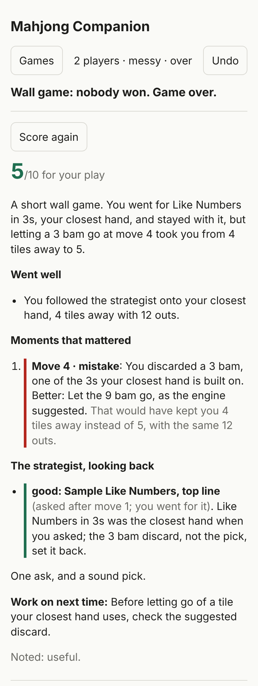<br/>
  <em>A wall game, reviewed: a score for my play, the move that cost me, and the strategist's pick judged with hindsight.</em>
</p>

<sub>As with the strategist above, this was captured without an API key: the review's wording is a placeholder from a scripted stand-in, written to match what the engine's replay found for this game (move 4: the engine suggested the 9 bam; the 3 bam left me 5 tiles away instead of 4). The real reviews come from Claude.</sub>

It works the same way as everything else here: **the engine counts, the AI judges.**

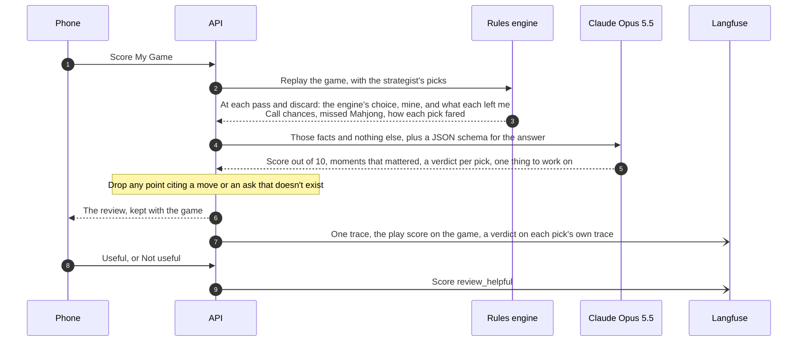

1. **The engine replays the game** ([`hindsight.py`](AI_Observability/hindsight.py)). At each Charleston pass and each of my discards it records:
   - what the engine would have done;
   - what I did;
   - how far my closest hand was afterwards, either way.

   It also lists the discards I could have called, any Mahjong I had and didn't declare, and the discards an opponent's likely hand needed. For each time I asked the strategist, it records where that hand stood, which of its tiles turned up later and whether it was still possible at the end. The strategist's picks and my "I'll go for it" taps are now saved with the game for this.
2. **Claude Opus 5.5 gets those facts and nothing else** ([`review.py`](AI_Observability/review.py)). The prompt asks it to score decisions, not luck (a well-played game can be lost to the draw). It is also told the engine is a guide, not an oracle: keeping a tile an opponent needs can beat the engine's discard. The answer is a fixed JSON shape:
   - a score out of 10 for my play;
   - what went well;
   - the 3 to 5 moves that mattered;
   - a good, reasonable or poor verdict on each strategist pick, judged on what could be known when I asked, not on how the draw went;
   - one thing to work on.
3. **The review is kept with the game**, so reopening it costs nothing; "Score again" replaces it.

#### Keeping the reviewer honest

- **It can only cite what the engine found.** Every number in its input comes from the replay. Any moment or verdict that points at a move or an ask that doesn't exist is dropped before I see it, and counted (`review_dropped_refs`).
- **A stronger model grades a weaker one.** The strategist is Claude Sonnet 5.5; the reviewer is Claude Opus 5.5. It is still Claude grading Claude, which is why it only gets the engine's facts and why my own "Useful?" tap is scored too.
- **The verdicts land where they are useful.** Each strategist verdict is written onto that pick's own trace (`strategist_hindsight`), so the strategist's dashboards show how its picks held up. The play score goes on the game (`review_play_score`), next to whether I won.
- **It costs money, once a game.** About $0.10 to $0.20 a review, by my estimate; the first real reviews will measure it.

Code: [`AI_Observability/review.py`](AI_Observability/review.py), [`AI_Observability/hindsight.py`](AI_Observability/hindsight.py), and the tests in [`tests/test_review.py`](AI_Observability/tests/test_review.py) and [`tests/test_hindsight.py`](AI_Observability/tests/test_hindsight.py).

#### Why not a local judge

My first design was different. An open model (Gemma 4 12B) on my desktop would grade each strategist pick on four pass/fail checks, calibrated against 18 answers I had labelled by hand. I built it and tested it against a stand-in. Before ever running it on the real model, I asked whether it was the right call, and decided it wasn't:

- A 12B model reasons less well than the Sonnet strategist it was grading.
- It graded one sentence without knowing how the game went.
- It needed my desktop and a calibration run before any score meant anything, and with a game or two a week it would have had very little to grade.
- It told me nothing at the table.

So I replaced it with the review ([Design decision 8](Design_Decisions/0008-review-a-finished-game-with-claude.md)). Its prompt, dataset and score definitions are still in my Langfuse project, unused. The dashboard setup now keeps tiles it doesn't place itself, so its old tiles weren't wiped.

### Drift: has anything changed?

There are two ways to be fooled here, so there are two tools.

**1. Compare two windows of time.** [`scripts/drift.py`](AI_Observability/scripts/drift.py) reads what the app recorded and compares the last two weeks with the two months before, feature by feature: tokens, cost and latency per call, cost per strategist ask, the share of heard lines that need Jev, and every score above.

- A change is only called drift when it is **large** (15% for tokens, cost and latency; 10 points for a pass rate) **and unlikely to be chance**: a permutation test, corrected for the number of metrics tested at once, because with dozens of metrics something always looks significant.
- A large move on too little data is reported as **watch**, not as a finding.
- A metric with fewer than five values in either window says **not enough data** instead of guessing.
- New models, prompt versions and releases are listed first, because they are the usual explanation.

This is from the first report on my own traces. I have only played with listening on two days so far, October 30 and November 13, so I set the windows to put one on each side:

```
## What changed between the windows
No new model, prompt version or release.

## Drift
| Feature | Metric | Baseline | Recent | Change | p | Verdict |
| table talk | heard lines sent to Jev | 57% (n=144) | 13% (n=45) | -44 pts | <0.001 | better |
| table talk | heard lines read right | 87% (n=70) | 98% (n=41) | +10 pts | 0.095 | watch |

## Steady
| table talk | cost per call | $0.000048 (n=82) | $0.000048 (n=6) | 0% | 0.191 | steady |
| table talk | latency per call (median) | 0.14 s (n=82) | 0.13 s (n=6) | -5% | 0.694 | steady |
| table talk | prompt tokens per call | 1,139 (n=82) | 1,135 (n=6) | 0% | 0.191 | steady |

## Not enough data yet (fewer than 5 values in a window)
- strategist: picks the player followed (1 in the baseline, 0 recent)
- strategist: cost per ask (2 in the baseline, 0 recent)
- ...
```

The report found a change I hadn't gone looking for: the share of heard lines that had to go to Jev fell from 57% to 13%. My best explanation is the parser work at the end of October, which taught it to hear an announcement inside a longer sentence. Lines read right also rose, from 87% to 98%, but on that much data it could still be luck, so it says "watch". And it is honest that I haven't asked the strategist often enough yet to say anything about it. Code: [`AI_Observability/drift.py`](AI_Observability/drift.py).

**2. Hold the inputs still.** Real games change from night to night, so a dip could be the model or just a harder game. [`scripts/strategist_eval.py`](AI_Observability/scripts/strategist_eval.py) asks the strategist about nine made-up positions that never change, each built to test something:

| Position | What it tests |
| --- | --- |
| Three sets of 3s already made | The easy case: one hand is far closer than the rest |
| All four winds, two 5 bams already discarded | The closest hand is concealed, and its tiles are getting scarce |
| An opponent exposed 3 dots with a joker, and I hold a 3 dot | A joker swap is on, and the closest hand has the fewest outs |
| I called four north winds | Only one hand is left to choose |
| Like numbers in 7s is closest, but the 7s keep getting discarded | Whether it reads the table, not just the distance |

Each run is recorded as a Langfuse experiment on a dataset, and Langfuse lines the runs up side by side. When two runs differ, the system changed, not the games. A run costs about ten cents. Code: [`AI_Observability/evalset.py`](AI_Observability/evalset.py) and [`AI_Observability/experiments.py`](AI_Observability/experiments.py).

### The game as a play-by-play

Next to the AI traces, every move is written to the same session as an event named like the move, with where it came from (a tap, an auto-logged line, a confirmed line, call advice, a fix) and my position after it. Open a session and it reads as a replay with the AI steps in between:

```
event  3. Player 2 discards north wind         source: tap
trace  heard    "seven dot" -> discard 7 dot, 0.9 sure            decided by: grammar
event  4. Player 3 discards 7 dot              source: auto, heard "seven dot"
score  discard_parse_correct = 1  (auto)
trace  heard    "call" -> call, 0.7 sure                          decided by: grammar
score  discard_parse_correct = 1  (confirmed)
event  5. Player 4 calls and exposes 3x 7 dot  source: heard, heard "call"
trace  heard    "eight crack" -> discard 8 crak, 0.9 sure         decided by: grammar
event  6. Player 4 discards 8 crak             source: auto, heard "eight crack"
score  discard_parse_correct = 1  (auto)
event  7. You draw flower                      source: tap
                                               top hand: Sample Runs, top line (1999-RUN-1), 5 away
trace  strategist  -> 1999-RUN-1               claude, opponent_reads, claude, hand_details, claude
score  recommendation_followed = 1
```

<sub>This is what the app recorded for the game in the screenshots above, condensed to a line each. I ran the real code locally with Langfuse swapped for a recorder and the model for the test suite's stand-in, so the names, nesting, sources and scores are the ones the deployed app sends.</sub>

When the game ends (someone declares Mahjong, or nobody does and the tiles run out), a "Game over" summary is added (who won, how many moves, how many discards were tapped versus heard), the game is scored as a whole on its session, and the trace buffer is flushed, because the app may scale to zero seconds later. Recording can never break a game: any Langfuse error is logged and swallowed. Code: [`AI_Observability/playbyplay.py`](AI_Observability/playbyplay.py).

### Dashboards, and a Langfuse project kept in code

A Langfuse project collects settings that nobody remembers making. So mine are in code: [`scripts/langfuse_setup.py`](AI_Observability/scripts/langfuse_setup.py) creates whatever is missing and changes only what differs, and a second run changes nothing.

- **A definition for every score**: its type, range and meaning, so Langfuse explains each score where it shows it.
- **Every prompt, mirrored under a fingerprint.** The prompt text stays in the code, where the tests are. The script registers each version in Langfuse under a `sha-<fingerprint>` label, and the app links each call to it. Langfuse can then show cost, latency and scores per prompt version, and what any old fingerprint actually said.
- **The fixed positions** as a dataset.
- **Four dashboards:**

| Board | What it shows |
| --- | --- |
| Mahjong Companion | One evening at a glance: games, moves, accuracy, cost |
| Mahjong: AI quality | Strategist picks in hindsight, reviews I found useful, my play score game by game, picks followed, engine rank of the pick, how asks end, fixes per photo |
| Mahjong: cost and tokens | Cost by feature, call and model, tokens and latency per call, prompt versions in use, failed and fallback calls |
| Mahjong: judge and evals | The fixed positions over time and the cost of test runs (the retired judge's tiles sit below, unused) |

The first three read real games only. The fourth reads test runs only. Before adding a widget, the script asks Langfuse the widget's question read-only, so a query that Langfuse would reject is caught before anything is created. Code: [`AI_Observability/langfuse_setup.py`](AI_Observability/langfuse_setup.py).

### What reading my own traces turned up

Building all this meant reading back what the app had actually been sending. Three things were wrong, and none of them would have shown up in a test:

- **Every Claude call was being counted twice.** The Anthropic SDK emits its own OpenTelemetry span for each API call, and Langfuse stored it as a second generation with its own cost. My dashboard said $2.53 of AI cost. The real figure was $1.37. Those spans are no longer exported, and a test now runs the real Anthropic and Langfuse SDKs against a local stand-in server to prove it: with the filter each call arrives once, without it twice ([`tests/test_tracing_e2e.py`](AI_Observability/tests/test_tracing_e2e.py)).
- **Two dashboard tiles had been showing nothing.** They filtered scores by session, which Langfuse only matches for scores on a whole game, never for scores on a trace.
- **The strategist ignores its word limit.** The prompt asks for one sentence of at most 25 words. The two reasons from real games ran to 28 and 31. Nobody would have noticed; `reason_within_limit` now counts it.

### Measuring before shipping

The same scores are used offline. [`scripts/vision_eval.py`](AI_Observability/scripts/vision_eval.py) runs the photo reader over my labelled tile photos, and [`scripts/draft_card.py`](AI_Observability/scripts/draft_card.py) scores a card draft against a card I have checked. Both write to Langfuse exactly as the live app does, but under the `eval` environment, so an experiment and real play can be compared without being mixed. Both also refuse to run without `--yes`, because they spend money.

| Decision | What the numbers said |
| --- | --- |
| Which prompt for reading tiles | Generic description: 40 of 43. Describing my actual set: 42 of 43. |
| Where to cut off Jev's "is this a discard?" | Vendor default 0.7 loses half the announcements. 0.4 keeps 5 of 6 and drops all chatter. |
| Whether Opus can be trusted to draft a card | 54 of 55 hands on the 2024 card in one round. Still reviewed by me. |

Each feature also has an exit check tied to its score: I follow the strategist's pick most of the time, a hand photo needs at most one fix on average, and most discards are logged with no fix.

And the wiring itself has a check. [`scripts/langfuse_smoke.py`](AI_Observability/scripts/langfuse_smoke.py) sends one made-up action per feature through the real code into Langfuse, under an environment of its own that no dashboard reads, then reads the traces back and checks eleven things: the right session and environment, tagged, versioned, linked to their prompt, priced once, scored.

---

## Part 3: Cloud infrastructure

The app runs in Azure. It had three requirements: private, cheap when idle, and no secrets anywhere they don't belong.

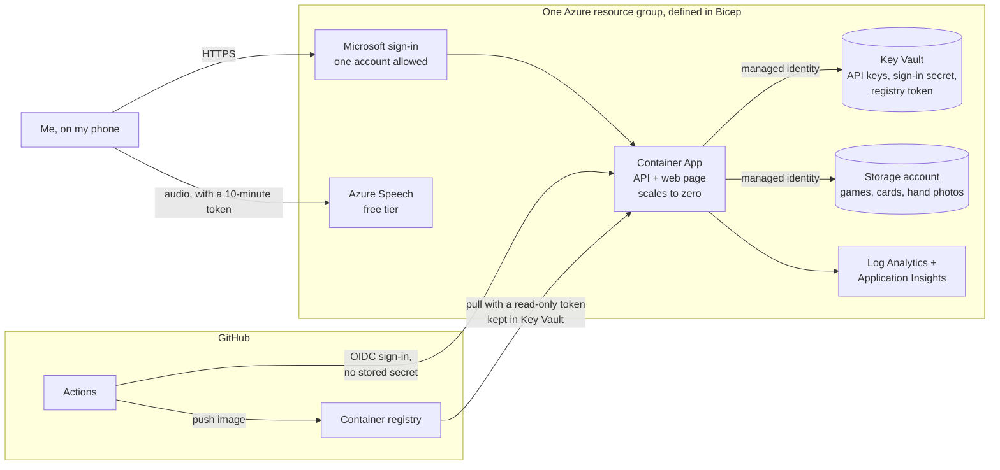

| Resource | Purpose |
| --- | --- |
| Container App | One container serves both the API and the web page. Scales to zero between games. |
| Microsoft sign-in (built into Container Apps) | In front of everything. Admits one account, by object ID. |
| Key Vault + managed identity | Holds the Anthropic, Langfuse and TypeSafe keys, the sign-in secret and the registry token. The app reads them through its identity, with no password. |
| Storage account | Private blobs: one JSON file per game, the card files, and hand photos with their corrected labels. Public access is off. |
| Azure Speech (F0) | Speech to text. Free up to 5 audio hours a month, and it stops rather than bills beyond that. |
| Log Analytics + Application Insights | Logs and non-LLM telemetry. LLM traces go to Langfuse. |
| Budget | Emails me at 80% of $30 a month. |

All of it is one Bicep file: [`Cloud_Infrastructure/main.bicep`](Cloud_Infrastructure/main.bicep). The strategist, listening and Jev are each a switch (`enableStrategist`, `enableSpeech`, `enableJev`), so a feature only gets its keys once they are in the vault.

### Where the secrets live

- **In Key Vault, never in code.** The code reads keys from environment variables. In Azure those variables are Key Vault references resolved by the app's managed identity, which can read secrets and read and write the blobs, and nothing more. The one key that skips the vault is the Speech key: Bicep takes it straight from the Speech resource into the app's settings, so it never passes through my hands at all.
- **GitHub holds no Azure secret.** The deploy workflow signs in with OIDC: Azure trusts a short-lived token that GitHub issues for one specific repository and environment. The IDs it uses are plain repository variables, not secrets.
- **The phone never sees a key.** For speech, the server trades its Speech key for a 10-minute token and hands the phone only that ([`Cloud_Infrastructure/speech.py`](Cloud_Infrastructure/speech.py)). Audio goes straight from the phone to Azure Speech and is never stored. Only the text reaches the app.
- **One front door.** Serving the page and the API from one container means one address, and the built-in sign-in covers both. With the page and API hosted separately, sign-in would have protected the page and left the API open.

### From pull request to production

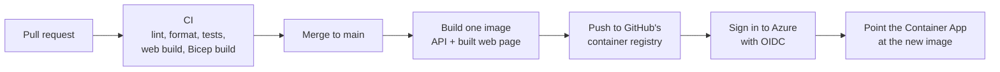

Every change goes through a pull request (32 so far), and CI runs the Python linter and formatter, the test suite (302 tests today), the web build and a Bicep build. A merge to `main` deploys on its own, one deploy at a time: a concurrency group queues them, because Azure rejects an update while another is in progress. Changes to the infrastructure itself are deployed by hand. The deploy also stamps the image with its git commit and the word "production", which Langfuse records on every trace as the release and the environment. Files: [`ci.yml`](Cloud_Infrastructure/ci.yml), [`deploy.yml`](Cloud_Infrastructure/deploy.yml), [`Dockerfile`](Cloud_Infrastructure/Dockerfile).

### What it costs

Keeping this cheap was a design goal, not an accident:

- **Scale to zero** means the container costs nothing between games.
- **GitHub's registry instead of Azure Container Registry** saves about $5 a month.
- **Free tier speech**, and a rules-first parser so most lines never reach a model.
- **The strategist only runs when asked**, at low effort with prompt caching, and the game review only when I press the button.

Idle cost is well under a dollar a month, and the AI calls come to cents per game.

---

## What is in this folder

| Path | What it is |
| --- | --- |
| [`LLM_Orchestration/`](LLM_Orchestration/) | The strategist agent and its tests, photo reading, card drafting, the table-talk pipeline and the Jev client. |
| [`AI_Observability/`](AI_Observability/) | The tracing module, the game review and the engine replay behind it, the drift report, the fixed test set, the Langfuse setup kept in code, the play-by-play recorder, and the scripts and tests that go with them. |
| [`Cloud_Infrastructure/`](Cloud_Infrastructure/) | The Bicep file, Dockerfile, CI and deploy workflows, blob storage access and the speech token endpoint. |
| [`Design_Decisions/`](Design_Decisions/) | The eight short decision records behind the design. |
| [`Images/`](Images/) | Screenshots of the app running on the made-up sample card. |

The source files are copies from the private repository. Each is marked at the top with where it came from, and they are otherwise unchanged except for one example line in the card-drafting prompt, which was swapped for a made-up one.

## What is not here, and why

- **No Langfuse project.** The dashboards, traces and scores live in my private Langfuse project. What is here is the code that builds and reads them.
- **No keys, tokens or connection strings.** The code only ever reads them from environment variables, and the real values live in Azure Key Vault. Nothing in this folder can call my Anthropic, Langfuse, TypeSafe or Azure accounts.
- **No way in to the running app.** Its address is not published, and it sits behind a Microsoft sign-in that admits a single account.
- **No working pipeline.** The two workflow files sit outside `.github/workflows`, so GitHub never runs them here. The real deploy trusts only the private repository.
- **No card data and no photos.** The NMJL card is copyrighted, so real card files and photos never enter git, in either repository. Everything shown here uses a made-up sample card.
- **Not the rules engine or the web app.** They stay in the private repository, which is why the files here can be read but not run.

## Design decisions

Each of these is a short record in [`Design_Decisions/`](Design_Decisions/).

1. [A deterministic engine sits at the center; AI sits at the edges](Design_Decisions/0001-engine-at-the-center.md)
2. [NMJL card data never enters git](Design_Decisions/0002-card-data-stays-private.md)
3. [Attribute discards by turn order, not by voice](Design_Decisions/0003-players-by-turn-order.md)
4. [Jev for the game-talk filter, Claude for the hand pick](Design_Decisions/0004-jev-for-typed-decisions.md)
5. [Cards are TOML files in a notation that mirrors the printed card](Design_Decisions/0005-card-format.md)
6. [One container behind Microsoft sign-in, image in GitHub's registry](Design_Decisions/0006-one-container-behind-sign-in.md)
7. [Measure every AI step the same way, and judge it with a local model](Design_Decisions/0007-measure-the-ai-and-judge-it-locally.md) (the judge part replaced by 8)
8. [Review a finished game with Claude, instead of judging picks with a local model](Design_Decisions/0008-review-a-finished-game-with-claude.md)

## Where it stands

The engine, the tap-only app, the strategist, photo reading, card drafting and live listening are all built and deployed, and I have played full games with it. The observability layer in Part 2 is built too, and its Langfuse side (score definitions, prompts, datasets, dashboards) is live. What is next:

- **Score real games.** Score My Game is built and tested with a stand-in for Claude. The first real reviews will show what one costs and how long it takes, and my "Useful?" taps will show whether it is worth it.
- **A first run of the fixed positions**, to set the baseline that every later run is compared with.
- **A trained tile detector.** Claude's vision is the baseline. Every rack photo is saved with the tiles I confirmed, so the training set is building itself, and the `tile_cv_correct` score is the bar a detector has to beat.
- **Polish**, guided by the scores from real games.
