# Mahjong Companion

#### Created by Nick Pranske

My wife has gotten really into Mahjong lately. It's a game that we get to play together and introduce to friends who have never played it! It's really quite fun - the only problem is that **she usually beats me!** Well, that ends today. I built this app as a table-side companion to help me strategize and win against her.

This project is also one of my first experiences in heavily relying on AI to do most of the programming. There were defintely ups and downs of this.

##### The Pros:
1. Development was rapid and code is insanely organized (more on that in the cons)
2. Organization of this repository was very easy
3. Ability to iterate and improve was made much easier

##### The Cons:
1. My understanding of the project got out of hand as development quickly grew. This caused me to have to *read* code more than *write* it.
2. Ultra-optimization of the code makes it harder for me to read.


I built this both as a way to one-up my wife and as a portfolio project to showcase certain skills: **LLM agent orchestration**, **AI observability** and **cloud infrastructure**. This page walks through each of them. I had Claude organize this page to help the reader understand the architecture. This took a lot of iterations and input on my end, and I'm quite pleased with the accuracy of the result.

<table>
  <tr>
    <td valign="top" width="33%">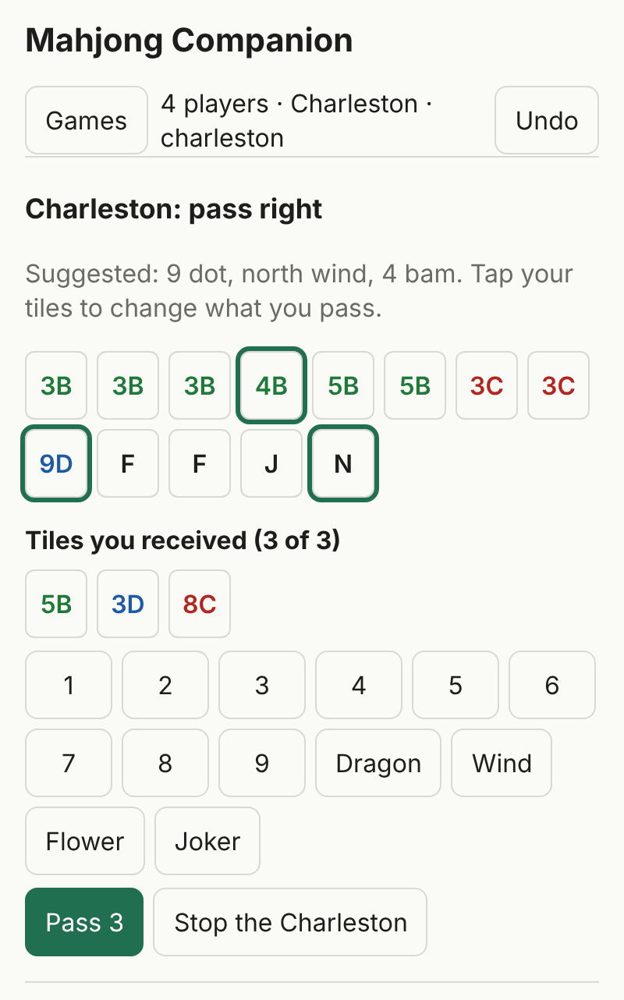</td>
    <td valign="top" width="33%">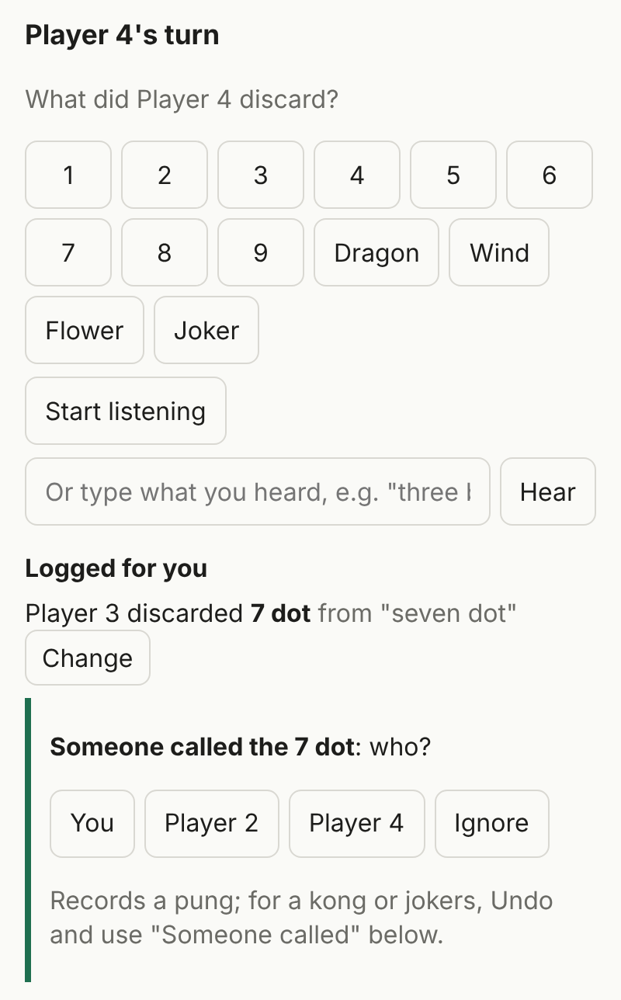</td>
    <td valign="top" width="33%">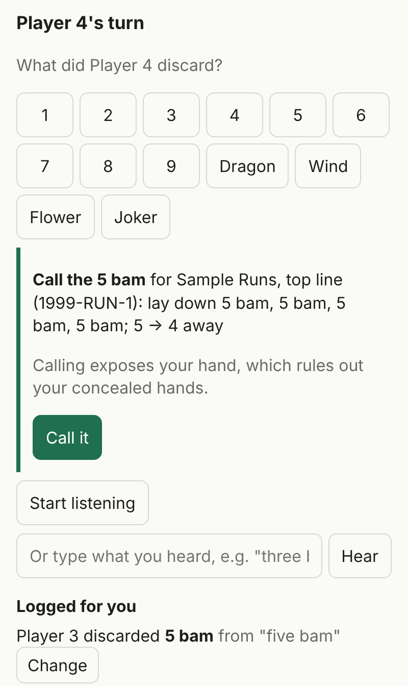</td>
  </tr>
  <tr>
    <td valign="top"><em>Charleston: the tiles worth passing are already selected.</em></td>
    <td valign="top"><em>Listening: "seven dot" was logged for me. Then someone said "call", so it asks who.</em></td>
    <td valign="top"><em>A discard I can use: what to call and what it gets me.</em></td>
  </tr>
</table>

<sub>Every screenshot on this page is the real app, run locally on a made-up sample card (hence "Sample Runs" and the year 1999). The actual card is copyrighted and never leaves private storage.</sub>

## Contents

1. [The game, and the problem](#the-game-and-the-problem)
2. [The one rule: the engine counts, the AI judges](#the-one-rule-the-engine-counts-the-ai-judges)
3. [Part 1: LLM orchestration](#part-1-llm-orchestration)
4. [Part 2: AI observability](#part-2-ai-observability)
5. [Part 3: Cloud infrastructure](#part-3-cloud-infrastructure)
6. [What is in this folder](#what-is-in-this-folder)
7. [What is not here, and why](#what-is-not-here-and-why)
8. [Design decisions](#design-decisions)
9. [Where it stands](#where-it-stands)

---

## The game, and the problem

American Mahjong is played with 152 tiles and a printed card of legal hands that changes every year. You win by building one of the hands on the card, 14 tiles exactly. The 2024 card has 55 hands, and because many of them allow "any suit" or "any three consecutive numbers", they expand to 1,683 distinct 14-tile targets.

So in the middle of a game there is a lot to hold in your head: which of those targets my tiles are close to, which tiles I still need have already been discarded, and what the other players seem to be collecting. The Companion keeps track of all of it on my phone.

## The one rule: the engine counts, the AI judges

Language models are unreliable at counting tiles. They are good at reading photos, making sense of messy speech and weighing soft signals. The whole design follows from that:

- A **rules engine** in plain Python, with no AI and no network calls, does everything that can be counted: every hand on the card, tiles still needed, live tiles left, dead hands, joker swaps, the best Charleston pass, whose turn it is.
- Each **AI part** sits at the edge. It either turns raw input (a photo, a sentence) into an event for the engine, or it chooses among options the engine has already scored.

Two things fall out of this. Every AI part can be measured against ground truth, because the engine or the player always knows the right answer. And the app still works with taps alone if every model is switched off.

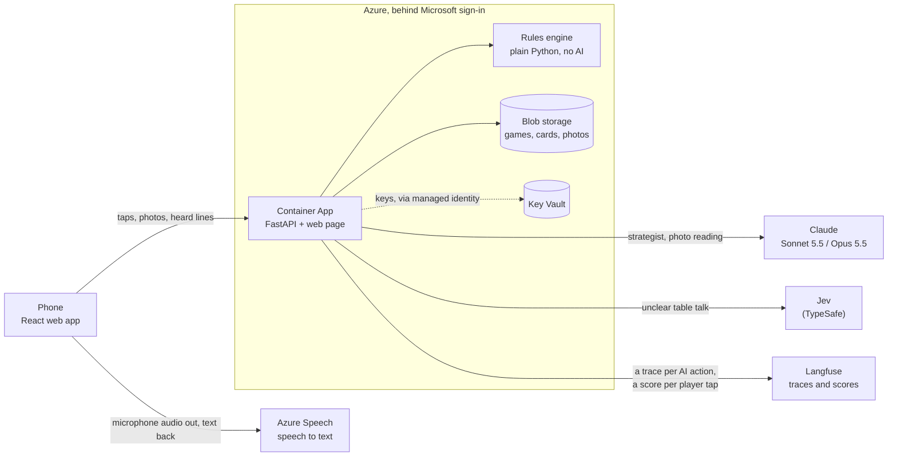

| Job | Done by |
| --- | --- |
| Every 14-tile target behind each card line, and validating a card file | Engine |
| Tiles still needed, live tiles, dead hands, joker swaps, ranking the hands | Engine |
| Which three tiles to pass in the Charleston, and the best discard | Engine |
| Whether to call a discard, and what each opponent is probably building | Engine |
| Game state: turns, calls, exposures, undo (a list of events, replayed) | Engine |
| **Which of the top hands to go for, and why** | Claude agent, choosing only among the engine's top 5 |
| **Reading tiles from a photo** | Claude vision, limited by schema to the 36 tile names |
| **Drafting a new year's card from a photo** | Claude, checked by the engine's validator in a loop |
| **Turning table talk into events** | Grammar parser first, a small typed model (Jev) for unclear lines |

---

## Part 1: LLM orchestration

There are four AI jobs, and each one has a different shape. I picked the smallest pattern that does the job, and the cheapest model that does it well.

| Job | Pattern | Model | Kept honest by |
| --- | --- | --- | --- |
| [Strategist](#the-strategist-an-agent-that-can-only-pick-from-the-engines-list) | Agent loop with tools | Claude Sonnet 5.5, low effort | Must answer through a tool, naming one of the engine's top 5 hands |
| [Photo reading](#reading-a-rack-photo-structured-output-not-free-text) | One call, structured output | Claude Sonnet 5.5 vision, low effort | A JSON schema that only allows the 36 real tile names |
| [Card drafting](#drafting-the-yearly-card-generate-validate-repair) | Generate, validate, repair | Claude Opus 5.5, high effort | The engine's validator, up to 4 rounds, then my review |
| [Table talk](#table-talk-rules-first-a-small-model-for-the-leftovers) | Cascade: rules, then a small model | Grammar parser, then Jev | Typed answers with probabilities, a measured cut-off, and my confirm tap |

### The strategist: an agent that can only pick from the engine's list

When I tap **Ask the strategist**, the engine ranks every hand on the card and hands Claude the top five, with tiles needed, live "outs" and joker swaps already counted. Claude's job is the judgment the engine can't make: are two opponents throwing away the suit I need, is a concealed hand worth giving up the right to call, is 17 outs better than 13 at the same distance.

<p align="center">
  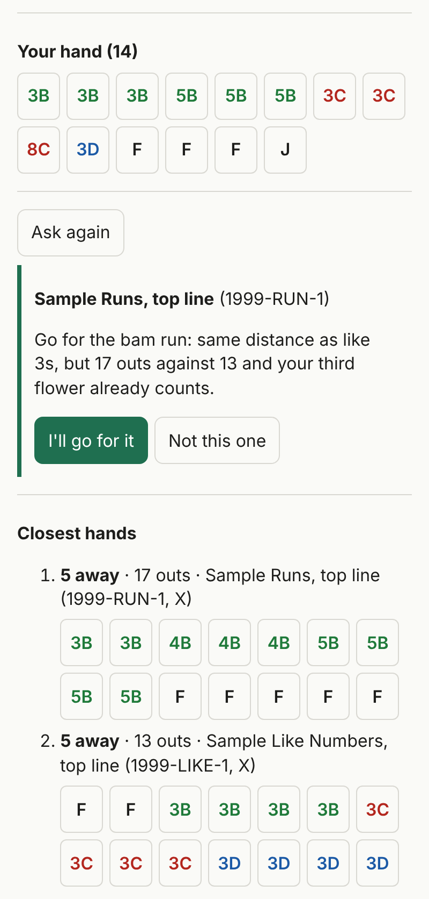<br/>
  <em>The pick sits between my hand and the engine's ranking. The two buttons under it become a score in Langfuse.</em>
</p>

<sub>This showcase was captured without any API key, so here the model call is replaced by the test suite's scripted stand-in (<code>FakeClaude</code>) and the wording of the reason is a placeholder. Everything else on screen is live output from the engine.</sub>

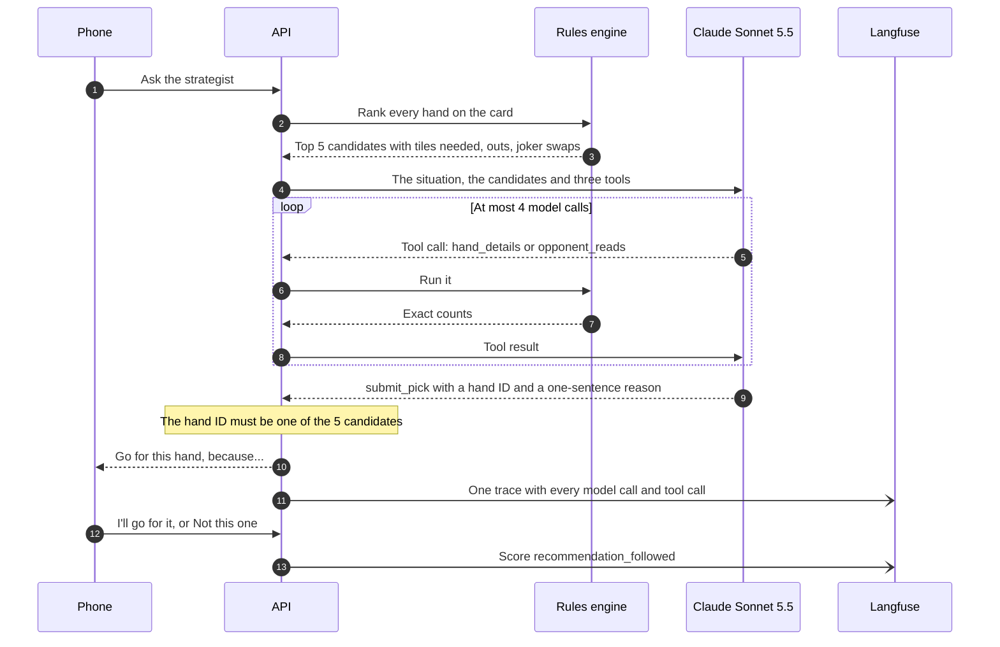

What makes it an orchestration problem rather than a prompt:

- **Three tools, all strict.** `hand_details` (the closest ways to finish one candidate), `opponent_reads` (each opponent's discards, exposures and the engine's guess at their hand), and `submit_pick` (the only way to answer).
- **It cannot invent a hand.** A `submit_pick` whose hand ID is not one of the five candidates is returned to the model as a tool error listing the valid IDs, and it tries again.
- **A text answer is nudged, not accepted.** If the model replies in prose, the loop answers "Call submit_pick with your choice."
- **A hard stop.** After 4 model calls with no pick, the request fails cleanly and the trace is marked as an error.
- **Refusals are handled twice.** Server-side fallback is on, so a declined request is retried on Anthropic's recommended fallback model, and a refusal that still comes back is an error rather than an empty answer.
- **Cheap on purpose.** Low effort, prompt caching, and it only runs when I tap the button: about a cent per ask, $0.08 to $0.17 over a game.

The loop itself is short. Abridged from [`LLM_Orchestration/strategist.py`](LLM_Orchestration/strategist.py):

```python
for _ in range(MAX_CALLS):  # 4
    response = _call_claude(client, langfuse, messages)
    if response.stop_reason == "refusal":
        raise StrategistError("The model declined to answer")
    messages.append({"role": "assistant", "content": response.content})
    results = []
    for block in response.content:
        if block.type != "tool_use":
            continue
        if block.name == "submit_pick" and block.input.get("hand_id") in by_id:
            return pick  # only an engine candidate gets out
        results.append(_run_tool(langfuse, block, card, state, by_id, reads or {}))
    if not results:
        # Answered in text instead of calling the tool: ask once more.
        results = [{"type": "text", "text": "Call submit_pick with your choice."}]
    messages.append({"role": "user", "content": results})
```

Each of those rules has a test that runs with a scripted model, so the suite needs no key and costs nothing: [`LLM_Orchestration/test_strategist.py`](LLM_Orchestration/test_strategist.py).

### Reading a rack photo: structured output, not free text

At the start of a game I photograph my rack instead of tapping in 13 tiles. The phone shrinks the photo to 1568 px, and Claude answers in a fixed JSON shape:

```python
"tile": {"type": "string", "enum": TILE_NAMES},   # the engine's 36 tile names and nothing else
"uncertain": {"type": "boolean"},                 # "I could be wrong about this one"
```

Because the names come from the engine, the reading drops straight into the tile picker. Tiles flagged `uncertain` are highlighted for me to check, and every tile I change is counted.

<p align="center">
  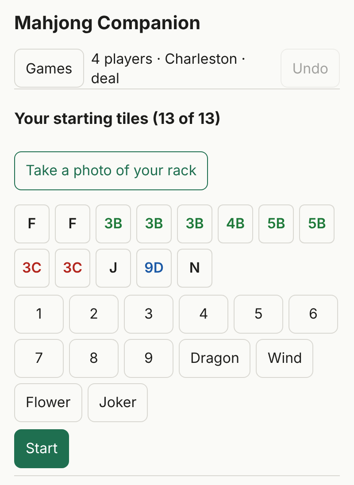<br/>
  <em>Photo or taps: both end in the same list of tiles, which I confirm before the game starts.</em>
</p>

The prompt was tuned by measuring, not guessing. A generic description of a Mahjong set read 40 of 43 single-tile photos correctly. Looking at the three misses showed why: my set marks the green dragon with an "F", its 8 bam looks like a W over an M, and one flower is drawn as bamboo. Describing the set I actually own raised it to 42 of 43. The prompt and schema are in [`LLM_Orchestration/vision.py`](LLM_Orchestration/vision.py).

### Drafting the yearly card: generate, validate, repair

A new card comes out every year, and typing its 50-odd hands into a file is slow and easy to get wrong. So I photograph the card, and Claude Opus 5.5 transcribes it into the engine's card format. This is the one job where accuracy matters far more than speed or cost (it runs once a year), so it gets the most capable model at high effort.

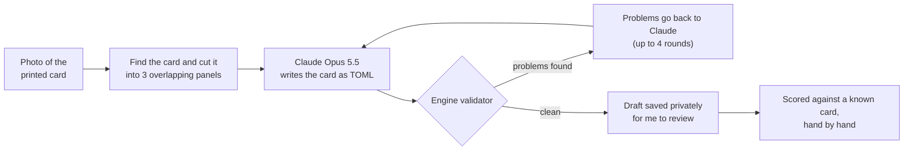

The model never grades its own work. The engine parses each draft and checks every hand: is it valid TOML, does every variant come to 14 tiles, are there enough of each tile in the set (or jokers allowed to cover the gap). What it finds goes back word for word. For example, this is what the validator says when one tile is missing from a hand on the made-up sample card:

```
1999-RUN-3: 13 tiles instead of 14 in 2x flower 1x 2 bam 1x 4 bam 1x 6 bam 1x 8 bam ...
```

Accuracy is scored **by meaning, not spelling**: a drafted hand counts as right only if it expands to exactly the same set of 14-tile targets, with the same value and concealed flag, as the same hand in a card file I already trust. On the 2024 card the draft got 54 of 55 hands right in a single round. A card costs roughly $0.25 to $1 to draft. Code: [`LLM_Orchestration/card_draft.py`](LLM_Orchestration/card_draft.py). The made-up card it uses as its format example: [`LLM_Orchestration/sample_card.toml`](LLM_Orchestration/sample_card.toml).

### Table talk: rules first, a small model for the leftovers

Players announce what they discard: "three bam", "soap", "north". The phone streams microphone audio to Azure Speech and gets text back, one line at a time. Most lines don't need a model at all.

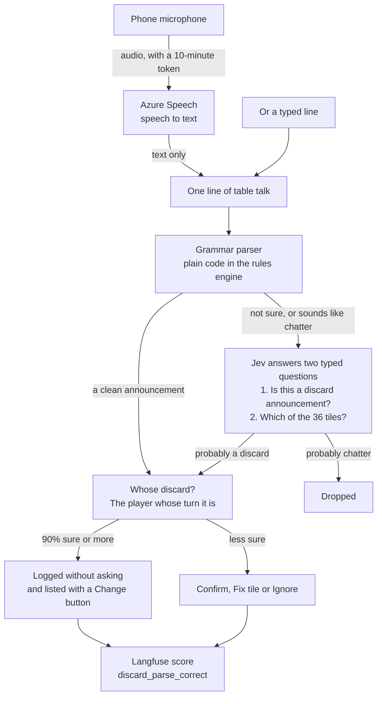

- **The parser handles the clean announcements.** It knows speech-to-text slips ("for dot" is 4 dot, "free crack" is 3 crak), reads a line sentence by sentence, splits two players' back-to-back announcements, and understands "three bam, no, four bam".
- **Jev only sees what the parser can't place.** [Jev](https://docs.typesafe.ai) (TypeSafe) answers typed questions with probabilities and writes no text. It gets two: a yes/no "is this a player naming the tile they are discarding now?", and a choice over the 36 tiles. A line costs about $0.00005. The model version is pinned, because the cut-off below was measured against it.
- **The cut-off was measured.** The vendor suggests 0.7 for a yes/no answer. On the 12 lines I calibrated with, announcements scored 0.93, 0.75, 0.75, 0.60, 0.48 and 0.17, and chatter scored 0.37 and below. At 0.7 half the announcements would be lost. At 0.4 it keeps 5 of 6 and drops all the chatter, and a stray proposal costs me one tap.
- **Who discarded comes from turn order, not voice.** Telling four voices apart in a noisy room is unreliable, so the app doesn't try. A discard belongs to whoever's turn it is, and a call moves the turn to the caller.
- **If Jev is down, the parser's reading stands**, so a line with a tile in it is still shown for me to confirm.

<p align="center">
  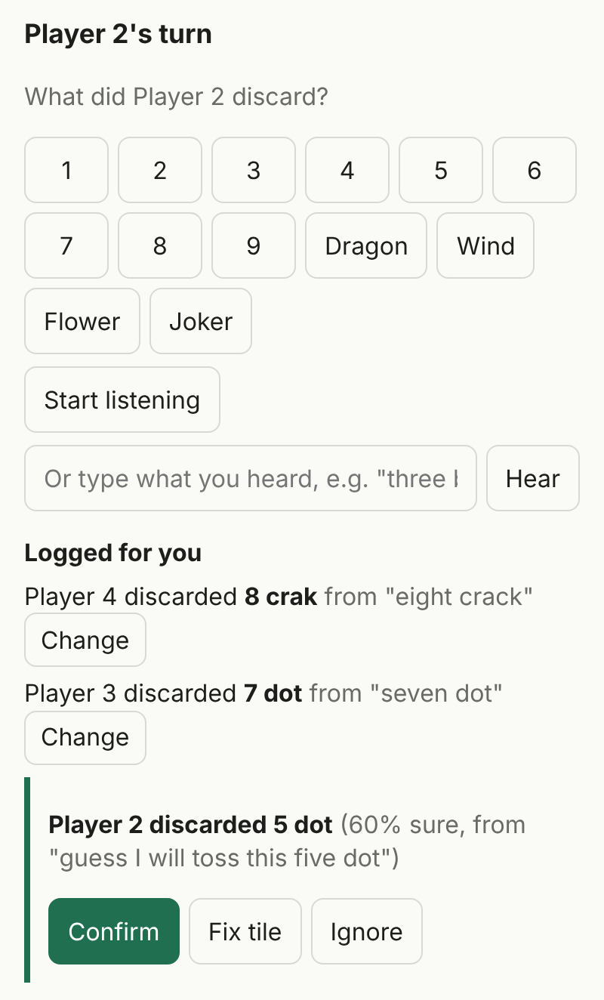<br/>
  <em>"Eight crack" and "seven dot" were logged on their own. "Guess I will toss this five dot" is only 60% sure, so it asks.</em>
</p>

Code: [`LLM_Orchestration/listen.py`](LLM_Orchestration/listen.py) and [`LLM_Orchestration/jev.py`](LLM_Orchestration/jev.py).

### What the engine adds around the AI

Not everything smart on the screen is a model. Calling advice and opponent reads are plain engine logic: an exposure is hard evidence about an opponent's hand, their discards are soft evidence, and with fewer than four discards the app says "too early to tell" instead of guessing. The strategist gets these reads through its `opponent_reads` tool.

<p align="center">
  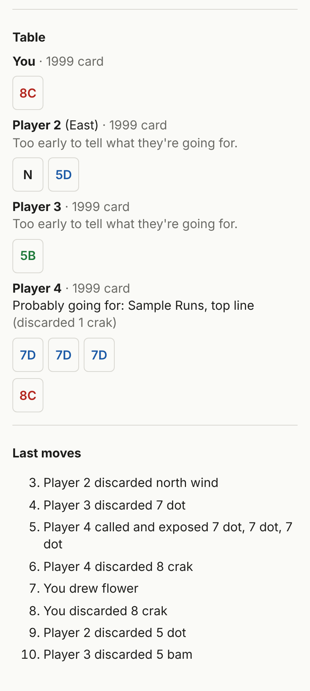<br/>
  <em>The table: who discarded what, what they exposed, and what that suggests.</em>
</p>

---

## Part 2: AI observability

Everything the AI does is recorded in [Langfuse](https://langfuse.com), and built so that every feature has a quality number from real play rather than a feeling.

### One trace per AI action, one session per game

Each action is a trace, and all traces of one game share a session (the game's ID), so a game opens as a single timeline. This is what each trace looks like:

```
strategist                agent        in: the 5 candidate hand IDs   out: hand ID + reason
├─ claude                 generation   claude-sonnet-5-5, effort low, tokens in/out/cached
├─ opponent_reads         tool
├─ claude                 generation
├─ hand_details           tool         in: {"hand_id": "1999-RUN-1"}
└─ claude                 generation   answers with submit_pick

heard                     chain        in: the line and whose turn    out: the proposed event
├─ parse-line             span         the grammar parser's reading and confidence
└─ jev                    generation   only when the parser is unsure: jev-1.13.0, tokens, cost

read-hand                 generation   claude-sonnet-5-5 vision; the photo itself is never logged

draft-card                agent        session: the card's year       out: rounds used, hands found
├─ claude-round-1         generation   claude-opus-5-5, effort high
├─ validate               tool         out: hands parsed and the list of problems
├─ claude-round-2         generation
└─ validate               tool         out: no problems
```

A few choices worth pointing out:

- **Token usage includes cache reads and writes**, so the saving from prompt caching shows up in cost, not just in theory.
- **Jev has no Langfuse integration, so I traced it by hand.** Each call is recorded as a generation with the pinned model, its token usage and a cost computed from the published price, so it sits next to the Claude calls in the same cost view.
- **Photos never go to Langfuse.** The trace records the prompt and the image size. The photo is kept in private storage with my corrected tiles, as training data for a future tile detector.
- **Errors are first-class.** A refused photo, an unreadable answer, a Jev outage or a strategist run that hits its call limit marks the trace as an error, with the reason.

### Every tap is a score

The app never asks me to rate anything. The buttons I would press anyway are the feedback:

| Score | Created when I... | Value | Answers the question |
| --- | --- | --- | --- |
| `recommendation_followed` | tap "I'll go for it" or "Not this one" | 1 or 0 | Do I actually trust the strategist's picks? |
| `tile_cv_correct` | confirm my tiles after a photo | share of tiles it read right | How many fixes does a photo need? |
| `discard_parse_correct` | confirm, fix or ignore a heard line (or leave an auto-logged one alone) | 1 or 0 | How often is a discard logged with no correction? |
| `card_draft_accuracy` | run the card drafter against a known card | share of hands right | Can I trust a draft of next year's card? |

One detail I like: a discard that was logged automatically is scored 1 straight away, but its score has a fixed ID. If I later press **Change** on it, the same score is overwritten with 0. So "auto-logged and never corrected" and "auto-logged, then fixed" are told apart without any extra bookkeeping.

### The game as a play-by-play

Next to the AI traces, every move is written to the same session as an event named like the move, with where it came from (a tap, an auto-logged line, a confirmed line, call advice, a fix) and my position after it. Open a session and it reads as a replay with the AI steps in between:

```
event  3. Player 2 discards north wind         source: tap
trace  heard    "seven dot" -> discard 7 dot, 0.9 sure            decided by: grammar
event  4. Player 3 discards 7 dot              source: auto, heard "seven dot"
score  discard_parse_correct = 1  (auto)
trace  heard    "call" -> call, 0.7 sure                          decided by: grammar
score  discard_parse_correct = 1  (confirmed)
event  5. Player 4 calls and exposes 3x 7 dot  source: heard, heard "call"
trace  heard    "eight crack" -> discard 8 crak, 0.9 sure         decided by: grammar
event  6. Player 4 discards 8 crak             source: auto, heard "eight crack"
score  discard_parse_correct = 1  (auto)
event  7. You draw flower                      source: tap
                                               top hand: Sample Runs, top line (1999-RUN-1), 5 away
trace  strategist  -> 1999-RUN-1               claude, opponent_reads, claude, hand_details, claude
score  recommendation_followed = 1
```

<sub>This is what the app recorded for the game in the screenshots above, condensed to a line each. I ran the real code locally with Langfuse swapped for a recorder and the model for the test suite's stand-in, so the names, nesting, sources and scores are the ones the deployed app sends.</sub>

When someone declares Mahjong, a "Game over" summary is added (who won, how many moves, how many discards were tapped versus heard) and the trace buffer is flushed, because the app may scale to zero seconds later. Recording can never break a game: any Langfuse error is logged and swallowed. Code: [`AI_Observability/playbyplay.py`](AI_Observability/playbyplay.py).

### Measuring before shipping

The same scores are used offline. [`AI_Observability/vision_eval.py`](AI_Observability/vision_eval.py) runs the photo reader over my labelled tile photos, and [`AI_Observability/draft_card.py`](AI_Observability/draft_card.py) scores a card draft against a card I have checked. Both write to Langfuse exactly as the live app does, so an experiment and real play can be compared in one place. Both also refuse to run without `--yes`, because they spend money.

| Decision | What the numbers said |
| --- | --- |
| Which prompt for reading tiles | Generic description: 40 of 43. Describing my actual set: 42 of 43. |
| Where to cut off Jev's "is this a discard?" | Vendor default 0.7 loses half the announcements. 0.4 keeps 5 of 6 and drops all chatter. |
| Whether Opus can be trusted to draft a card | 54 of 55 hands on the 2024 card in one round. Still reviewed by me. |

Each feature also has an exit check tied to its score: I follow the strategist's pick most of the time, a hand photo needs at most one fix on average, and most discards are logged with no fix.

---

## Part 3: Cloud infrastructure

The app runs in Azure. It had three requirements: private, cheap when idle, and no secrets anywhere they don't belong.

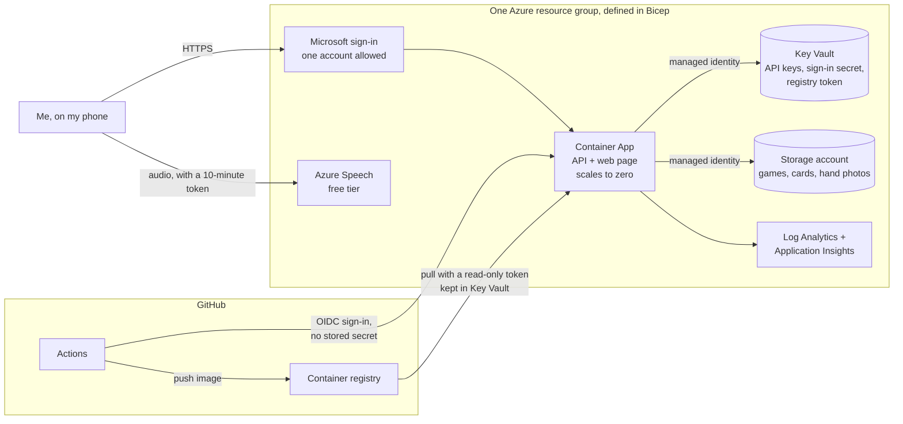

| Resource | Purpose |
| --- | --- |
| Container App | One container serves both the API and the web page. Scales to zero between games. |
| Microsoft sign-in (built into Container Apps) | In front of everything. Admits one account, by object ID. |
| Key Vault + managed identity | Holds the Anthropic, Langfuse and TypeSafe keys, the sign-in secret and the registry token. The app reads them through its identity, with no password. |
| Storage account | Private blobs: one JSON file per game, the card files, and hand photos with their corrected labels. Public access is off. |
| Azure Speech (F0) | Speech to text. Free up to 5 audio hours a month, and it stops rather than bills beyond that. |
| Log Analytics + Application Insights | Logs and non-LLM telemetry. LLM traces go to Langfuse. |
| Budget | Emails me at 80% of $30 a month. |

All of it is one Bicep file: [`Cloud_Infrastructure/main.bicep`](Cloud_Infrastructure/main.bicep). The strategist, listening and Jev are each a switch (`enableStrategist`, `enableSpeech`, `enableJev`), so a feature only gets its keys once they are in the vault.

### Where the secrets live

- **In Key Vault, never in code.** The code reads keys from environment variables. In Azure those variables are Key Vault references resolved by the app's managed identity, which can read secrets and read and write the blobs, and nothing more. The one key that skips the vault is the Speech key: Bicep takes it straight from the Speech resource into the app's settings, so it never passes through my hands at all.
- **GitHub holds no Azure secret.** The deploy workflow signs in with OIDC: Azure trusts a short-lived token that GitHub issues for one specific repository and environment. The IDs it uses are plain repository variables, not secrets.
- **The phone never sees a key.** For speech, the server trades its Speech key for a 10-minute token and hands the phone only that ([`Cloud_Infrastructure/speech.py`](Cloud_Infrastructure/speech.py)). Audio goes straight from the phone to Azure Speech and is never stored. Only the text reaches the app.
- **One front door.** Serving the page and the API from one container means one address, and the built-in sign-in covers both. With the page and API hosted separately, sign-in would have protected the page and left the API open.

### From pull request to production

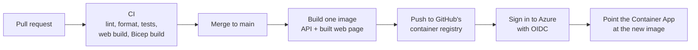

Every change goes through a pull request (28 so far), and CI runs the Python linter and formatter, the test suite (186 tests today), the web build and a Bicep build. A merge to `main` deploys on its own, one deploy at a time: a concurrency group queues them, because Azure rejects an update while another is in progress. Changes to the infrastructure itself are deployed by hand. Files: [`ci.yml`](Cloud_Infrastructure/ci.yml), [`deploy.yml`](Cloud_Infrastructure/deploy.yml), [`Dockerfile`](Cloud_Infrastructure/Dockerfile).

### What it costs

Keeping this cheap was a design goal, not an accident:

- **Scale to zero** means the container costs nothing between games.
- **GitHub's registry instead of Azure Container Registry** saves about $5 a month.
- **Free tier speech**, and a rules-first parser so most lines never reach a model.
- **The strategist only runs when asked**, at low effort with prompt caching.

Idle cost is well under a dollar a month, and the AI calls come to cents per game.

---

## What is in this folder

| Path | What it is |
| --- | --- |
| [`LLM_Orchestration/`](LLM_Orchestration/) | The strategist agent and its tests, photo reading, card drafting, the table-talk pipeline and the Jev client. |
| [`AI_Observability/`](AI_Observability/) | The play-by-play recorder, the API routes that turn taps into scores, and the two offline evals. |
| [`Cloud_Infrastructure/`](Cloud_Infrastructure/) | The Bicep file, Dockerfile, CI and deploy workflows, blob storage access and the speech token endpoint. |
| [`Design_Decisions/`](Design_Decisions/) | The six short decision records behind the design. |
| [`Images/`](Images/) | Screenshots of the app running on the made-up sample card. |

The source files are copies from the private repository. Each is marked at the top with where it came from, and they are otherwise unchanged except for one example line in the card-drafting prompt, which was swapped for a made-up one.

## What is not here, and why

- **No keys, tokens or connection strings.** The code only ever reads them from environment variables, and the real values live in Azure Key Vault. Nothing in this folder can call my Anthropic, Langfuse, TypeSafe or Azure accounts.
- **No way in to the running app.** Its address is not published, and it sits behind a Microsoft sign-in that admits a single account.
- **No working pipeline.** The two workflow files sit outside `.github/workflows`, so GitHub never runs them here. The real deploy trusts only the private repository.
- **No card data and no photos.** The NMJL card is copyrighted, so real card files and photos never enter git, in either repository. Everything shown here uses a made-up sample card.
- **Not the rules engine or the web app.** They stay in the private repository, which is why the files here can be read but not run.

## Design decisions

Each of these is a short record in [`Design_Decisions/`](Design_Decisions/).

1. [A deterministic engine sits at the center; AI sits at the edges](Design_Decisions/0001-engine-at-the-center.md)
2. [NMJL card data never enters git](Design_Decisions/0002-card-data-stays-private.md)
3. [Attribute discards by turn order, not by voice](Design_Decisions/0003-players-by-turn-order.md)
4. [Jev for the game-talk filter, Claude for the hand pick](Design_Decisions/0004-jev-for-typed-decisions.md)
5. [Cards are TOML files in a notation that mirrors the printed card](Design_Decisions/0005-card-format.md)
6. [One container behind Microsoft sign-in, image in GitHub's registry](Design_Decisions/0006-one-container-behind-sign-in.md)

## Where it stands

The engine, the tap-only app, the strategist, photo reading, card drafting and live listening are all built and deployed, and I have played full games with it. Two things are next:

- **A trained tile detector.** Claude's vision is the baseline. Every rack photo is saved with the tiles I confirmed, so the training set is building itself, and the `tile_cv_correct` score is the bar a detector has to beat.
- **Polish**, guided by the three scores from real games.
